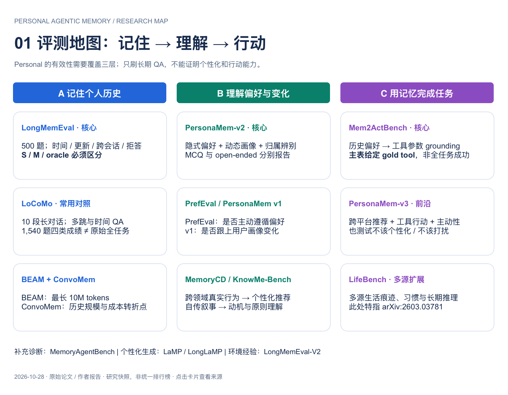

# Awesome Personal Agentic Memory 

精选个人助手长期记忆的论文、benchmark 和系统，关注 Agent 如何记住用户、理解用户，并根据个人历史采取合适行动。

**[English](README.md)** · **[评测结果与条件](docs/methods.md)** · **[图解](docs/visual-guide.md)** · **[贡献](CONTRIBUTING.md)**

资料快照：**2026-10-28** · **15 个 benchmark 家族** · **12 条方法/配置记录**。部分条目包含多个相关工作。

## 从这里开始

| 研究问题 | 起点 |
| --- | --- |
| 能记住用户事实、更新和时间吗？ | [LongMemEval](https://arxiv.org/abs/2410.10813) |
| 能理解隐式偏好并个性化回答吗？ | [PersonaMem-v2](https://arxiv.org/html/2512.06688v1) + [PrefEval](https://arxiv.org/abs/2502.09597) |
| 能把记忆用于行动吗？ | [Mem2ActBench](https://arxiv.org/html/2601.19935v1) |
| 哪些机制值得先读？ | [A-MEM](https://arxiv.org/abs/2502.12110)、[Hindsight](https://arxiv.org/html/2512.12818v1)、[PersonaMem-v2 RL](https://arxiv.org/html/2512.06688v1) |

## 目录

- [研究范围](#研究范围)
- [Benchmark 数据来源](#benchmark-数据来源)
- [Benchmarks](#benchmarks)
- [研究方法](#研究方法)
- [系统与实现](#系统与实现)
- [近期观察](#近期观察)
- [评测与结果](#评测与结果)
- [相关清单](#相关清单)
- [贡献](#贡献)

## 研究范围

**Personal**：历史中的个人证据会改变应当给出的回答或行动。**Agentic Memory**：Agent 对这些证据进行写入、组织、检索、更新和使用。

按三个层次标注用途：个人结果（偏好、画像、行动）、记忆组件（事实、时间、更新）和邻接诊断（通用记忆或环境经验）。事实问答能力是个人助手的基础，但不能单独证明个性化行动有效。

展开 Benchmark 能力地图（可编辑图见链接）

[全部三页图解](docs/visual-guide.md) · [可编辑 draw.io](assets/personal-memory-eval.drawio)

## Benchmark 数据来源

**先看数据来自谁，再看榜单分数。** 按被评估的个人历史 / 行为来源分类：**真人数据**来自实际用户记录；**合成数据**由人设、脚本或模拟器构造；**混合数据**结合真实语料与合成内容，具体作用见表。

**人工审核 ≠ 真人数据；模拟用户实时交互 ≠ 真人交互；真实数据作种子 ≠ 原始真人完整轨迹。** 本表先覆盖已核对的 12 项个人场景评测，其余条目不据名称推断。

| Benchmark | 真人还是合成？ | 数据怎样构造 | 榜单主要反映什么 |
| --- | --- | --- | --- |
| [MemoryCD](https://arxiv.org/html/2603.25973v1) | **真人数据** | 真人 Amazon 评分、评论与跨领域行为记录；据此构造预测和文本生成任务。 | 预测用户评分、排序与评论；并非真人在线满意度实验。 |
| [PersonaMem-v3](https://arxiv.org/html/2608.21381v1) | **混合数据** | 真人行为先聚合、重采样为合成用户，再由 LLM 推断偏好并扩展多平台生活记录。 | 行为依据上的个性化；不能视作原始真人完整生活轨迹。 |
| [PrefEval](https://arxiv.org/html/2502.09597v1) | **混合数据** | LLM 生成偏好与问题，经人工筛选；插入真实 LMSYS 聊天作为干扰。核心用户偏好是合成的。 | 长历史中的偏好遵循；真实干扰不代表同一真人的历史。 |
| [Mem2ActBench](https://arxiv.org/html/2601.19935v1) | **混合数据** | 整合 ToolACE、BFCL、OASST1 等不同来源语料，重组事实链；先定工具参数，再反向生成问题。 | 个人约束驱动的参数补全；主要实验给定工具，不是实际执行成功率。 |
| [PersonaBench](https://arxiv.org/html/2502.20616v1) | **合成数据** | 合成人设 → 社交图与画像 → 聊天、购买等私人文档 → 个人问题。 | 从文档还原个人属性及关系。 |
| [PersonaMem v1](https://arxiv.org/html/2504.14225v1) | **合成数据** | PersonaHub 人设 → 偏好变化时间线 → 模拟会话 → 按当前状态出题。 | 追踪并使用当前有效的个人偏好。 |
| [PersonaMem-v2](https://arxiv.org/html/2512.06688v1) | **合成数据** | 合成人设与偏好 → 隐含线索对话 → QA；GPT-5 生成并过滤。 | 隐含偏好理解、归属辨别与个性化回答。 |
| [PerMemBench](https://arxiv.org/html/2605.25535v1) | **合成数据** | Nemotron 合成人设 → 长期/临时用途 → 项目与参考记忆 → 双模拟器对话。 | 应保留的个人记忆留存率；不是最终回答质量。 |
| [AMemGym](https://arxiv.org/html/2603.01966v1) | **合成数据** | 合成人设 → 评估问题 → 状态变量及变化 → 用户模拟器与被测助手实时交互。 | 持续交互中的状态维护；真人并未参与这些评测交互。 |
| [PraxisMemBench](https://arxiv.org/html/2610.20022v1) | **合成数据** | 合成人设和事件，结合工程师搭建的有状态应用、SOP 与经过执行验证的任务。 | 个人记忆与流程结合；须区分记忆诊断 SR 和严格执行成功。 |
| [OP-Bench](https://arxiv.org/html/2601.13722v2) | **合成数据** | 以 LoCoMo 的合成对话抽画像，再生成过度个性化探针，经人工审核筛选。 | 无关引用、重复与迎合的压力测试。 |
| [PersistBench](https://arxiv.org/html/2602.01146v1) | **合成数据** | 生成记忆集合与查询，用搜索寻找易触发失败的组合，再人工验证。 | 记忆误用压力测试；失败率不代表自然使用中的发生率。 |

依据论文正文/附录描述，尚未逐条审计全部发布数据。分类快照：2026-10-28。结构化记录：[benchmark-provenance.json](data/benchmark-provenance.json)。

## Benchmarks

每项附原始来源和详细证据卡，包含规模、指标与适用边界。

### 事实与历史

| 时间 | 工作 | 研究重点 | 资料 |
| --- | --- | --- | --- |
| 2024 | **LoCoMo** | 跨会话事实、多跳、时间推理；原始任务还包括事件总结和多模态对话生成。 | [原文](https://github.com/snap-research/locomo) · [评测详情](docs/benchmarks.md#1-locomo) |
| 2024 / ICLR 2025 | **LongMemEval** | 信息抽取、跨会话推理、时间推理、知识更新、拒答。 | [原文](https://arxiv.org/abs/2410.10813) · [Code](https://github.com/xiaowu0162/LongMemEval) · [评测详情](docs/benchmarks.md#2-longmemeval) |
| 2025 / 2026 | **BEAM** | 极长且连贯的对话中的多类记忆能力。 | [原文](https://arxiv.org/abs/2510.27246) · [评测详情](docs/benchmarks.md#3-beam) |
| 2025 | **ConvoMem** | 个人事实、助手信息、拒答、偏好、时间变化与隐式联系。 | [原文](https://arxiv.org/abs/2511.10523) · [评测详情](docs/benchmarks.md#4-convomem) |

### 偏好与用户理解

| 时间 | 工作 | 研究重点 | 资料 |
| --- | --- | --- | --- |
| 2025 | **PrefEval** | 显式 / 隐式偏好的推断、记忆和主动遵循。 | [原文](https://arxiv.org/abs/2502.09597) · [评测详情](docs/benchmarks.md#5-prefeval) |
| 2025 | **PersonaMem v1** | 随时间演化的画像和偏好；选择符合当前用户状态的回复。 | [原文](https://arxiv.org/abs/2504.14225) · [Code](https://github.com/bowen-upenn/PersonaMem) · [评测详情](docs/benchmarks.md#6-personamem-v1) |
| 2025 | **PersonaMem-v2** | 从自然任务对话推断隐式偏好，含动态变化、归属辨别与遗忘请求。 | [原文](https://arxiv.org/html/2512.06688v1) · [评测详情](docs/benchmarks.md#7-personamem-v2) |
| 2026 | **MemoryCD** | 跨领域评分预测、物品排序、评论总结和评论生成。 | [原文](https://arxiv.org/html/2603.25973v1) · [评测详情](docs/benchmarks.md#11-memorycd) |
| 2026 | **KnowMe-Bench** | 基于自传叙事，测事实、主观状态与原则层面的个人理解。 | [原文](https://arxiv.org/abs/2601.04745) · [评测详情](docs/benchmarks.md#12-knowme-bench) |

### 行动与多源信息

| 时间 | 工作 | 研究重点 | 资料 |
| --- | --- | --- | --- |
| 2026 | **PersonaMem-v3** | 跨平台画像、推荐、过度个性化、agentic tasks 与主动介入时机。 | [原文](https://arxiv.org/html/2608.21381v1) · [评测详情](docs/benchmarks.md#8-personamem-v3) |
| 2026 | **Mem2ActBench** | 把历史偏好和任务状态用于工具参数补全。 | [原文](https://arxiv.org/html/2601.19935v1) · [Code & data](https://github.com/Cantaloupe-M/Mem2ActBench) · [评测详情](docs/benchmarks.md#9-mem2actbench) |
| 2026 | **LifeBench** | 跨长期数字痕迹整合事实、经历、习惯与程序性线索。 | [原文](https://arxiv.org/abs/2603.03781) · [评测详情](docs/benchmarks.md#10-lifebench) |

### 邻接能力诊断

| 时间 | 工作 | 研究重点 | 资料 |
| --- | --- | --- | --- |
| 2025 / 2026 | **MemoryAgentBench** | 增量输入下的准确检索、测试时学习、长程理解、选择性遗忘。 | [原文](https://arxiv.org/abs/2507.05257) · [评测详情](docs/benchmarks.md#13-memoryagentbench) |
| 2023–2024 | **LaMP / LongLaMP** | 基于用户历史的个性化分类与生成；LongLaMP 扩展到长文本。 | [原文](https://arxiv.org/abs/2304.11406) · [2](https://arxiv.org/abs/2407.11016) · [评测详情](docs/benchmarks.md#14-lamp--longlamp) |
| 2026 | **LongMemEval-V2** | Web agent 对环境状态、流程、陷阱和前提的经验记忆。 | [原文](https://arxiv.org/abs/2605.12493) · [Code](https://github.com/xiaowu0162/LongMemEval-V2) · [评测详情](docs/benchmarks.md#15-longmemeval-v2) |

## 研究方法

按机制组织，便于选择对照实验；条目顺序不代表成绩排名。

### 学习式记忆管理

| 工作 | 研究重点 | 资料 |
| --- | --- | --- |
| **PersonaMem-v2 RL Agentic Memory** | GRPO 学习顺序压缩与更新一份有界、可读的用户记忆。 | [原文](https://arxiv.org/html/2512.06688v1) · [评测详情](docs/methods.md#1-personamem-v2-rl-agentic-memory) |

### 结构化记忆与检索

| 工作 | 研究重点 | 资料 |
| --- | --- | --- |
| **A-MEM** | Zettelkasten 式笔记、动态链接和记忆演化。 | [原文](https://arxiv.org/abs/2502.12110) · [System](https://github.com/agiresearch/A-mem) · [Paper experiments](https://github.com/WujiangXu/A-mem) · [评测详情](docs/methods.md#8-a-mem) |
| **Hindsight** | 事实、经历、摘要、信念分层；retain / recall / reflect，时间与实体感知检索。 | [原文](https://arxiv.org/html/2512.12818v1) · [Code](https://github.com/vectorize-io/hindsight) · [评测详情](docs/methods.md#2-hindsight) |
| **EverMemOS** | MemCells → MemScenes → agentic recollection，把片段整合为主题场景并重建证据。 | [原文](https://arxiv.org/html/2601.02163v1) · [Current repo](https://github.com/EverMind-AI/EverOS) · [评测详情](docs/methods.md#3-evermemos) |

### 图结构与强化学习对照

| 工作 | 研究重点 | 资料 |
| --- | --- | --- |
| **MAGMA / Memory-R1** | MAGMA：语义、时间、因果、实体多图检索；Memory-R1：RL 学习增删改和证据选择。 | [原文](https://arxiv.org/abs/2601.03236) · [2](https://arxiv.org/abs/2508.19828) · [评测详情](docs/methods.md#9-magma--memory-r1) |

## 系统与实现

| 工作 | 研究重点 | 资料 |
| --- | --- | --- |
| **Mastra Observational Memory** | Observer / Reflector 维护日期化观察日志，形成稳定可缓存上下文。 | [原文](https://mastra.ai/research/observational-memory) · [评测详情](docs/methods.md#4-mastra-observational-memory) |
| **Mem0 · 2026 temporal update** | 提取 / 更新事实，加入时间签名、时态和时间感知排序。 | [原文](https://mem0.ai/blog/introducing-temporal-reasoning-in-mem0) · [评测详情](docs/methods.md#5-mem0--2026-temporal-update) |
| **Zep · 2026 research page** | 时间失效管理 + 多范围图检索和重排，按预算组装上下文。 | [原文](https://www.getzep.com/research/) · [评测详情](docs/methods.md#6-zep--2026-research-page) |

已核实的源码入口：

- [A-MEM system](https://github.com/agiresearch/A-mem) · [A-MEM paper experiments](https://github.com/WujiangXu/A-mem). 系统库和论文实验仓库分开。
- [Hindsight](https://github.com/vectorize-io/hindsight). 当前项目入口，复现需要固定版本。
- [EverOS](https://github.com/EverMind-AI/EverOS). 论文的 EverMemOS 仓库链接目前跳转至此；不把当前代码默认视为论文版本。

## 近期观察

新作、配置级比较与指标待核条目，保留在观察区。

| 工作 | 研究重点 | 资料 |
| --- | --- | --- |
| **Agent Zero Memory** | 事件时间线 + 实体图 + 分层文档记忆；检索保留来源证据。 | [原文](https://arxiv.org/html/2608.29606v1) · [评测详情](docs/methods.md#7-agent-zero-memory) |
| **AgentMemRec / FlexA-Mem** | 前者把选记忆视为推荐排序；后者以不可变历史和预算自适应时间线恢复细节。 | [原文](https://arxiv.org/abs/2610.34673) · [2](https://arxiv.org/abs/2610.33274) · [评测详情](docs/methods.md#10-agentmemrec--flexa-mem) |
| **PersonaMem-v3 agentic search configurations** | Agent 使用工具在多平台历史中搜索与组合证据。 | [原文](https://arxiv.org/html/2608.21381v1) · [评测详情](docs/methods.md#11-personamem-v3-agentic-search-configurations) |
| **Supermemory** | 聚合式检索与记忆组织。 | [原文](https://supermemory.ai/research/) · [评测详情](docs/methods.md#12-supermemory) |

## 评测与结果

**起步组合：LongMemEval-S + PersonaMem-v2 + Mem2ActBench。** 分别衡量事实、个性化和工具参数；这是本清单的选型建议，不合成为统一总分。

| 要查什么 | 入口 |
| --- | --- |
| 各 benchmark 测什么、有哪些限制 | [Benchmark 证据卡](docs/benchmarks.md) |
| 方法报告了多少分、用了什么模型与 judge | [方法成绩与条件](docs/methods.md) |
| 如何固定预算、模型、指标并记录复现 | [评测协议与结果模板](docs/evaluation-protocol.md) |
| 结构化原始整理 | [catalog.json](data/catalog.json) |

成绩均为论文或作者报告，尚未独立复跑；机制说明也未全部核到源码。Recall@k、QA accuracy、偏好遵循率与任务成功率分开记录，宏平均与逐题平均分开记录。

## 相关清单

- [Awesome Personalized AI](https://github.com/LikeACloud7/awesome-personalized-ai) - 广义个性化研究与评测。
- [Awesome Personalized Graph Memory](https://github.com/icedpanda/awesome-personalized-graph-memory) - 图结构个人记忆。
- [Awesome Agent Memory](https://github.com/TeleAI-UAGI/Awesome-Agent-Memory) - 通用 Agent Memory 系统与研究。

## 贡献

补充条目时，请说明个人场景用途、原始来源和评测边界。见[贡献规范](CONTRIBUTING.md)、[待办](TODO.md)与[更新记录](CHANGELOG.md)。

页面结构参考 [Awesome-LLM](https://github.com/Hannibal046/Awesome-LLM)，采用重点入口、分类论文表和独立评测/实现资源区。见[设计说明](docs/design-references.md)。
