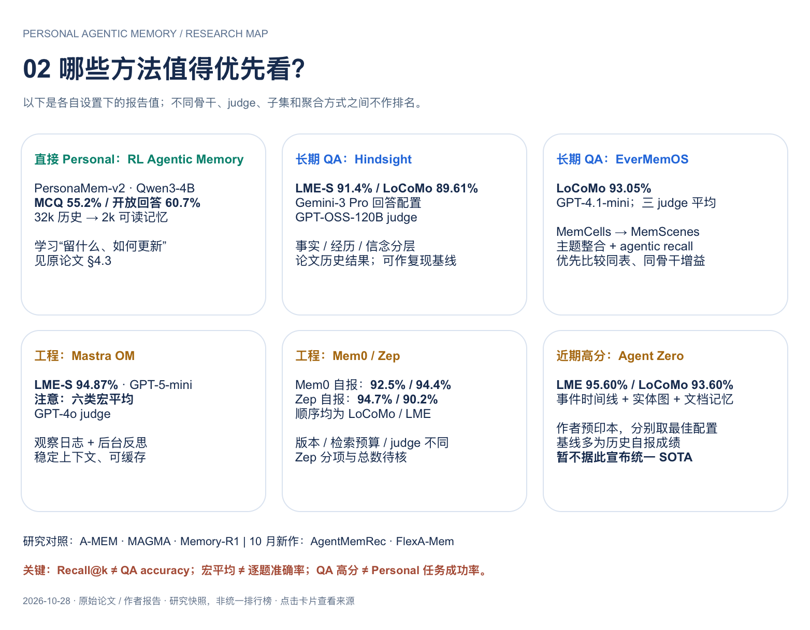
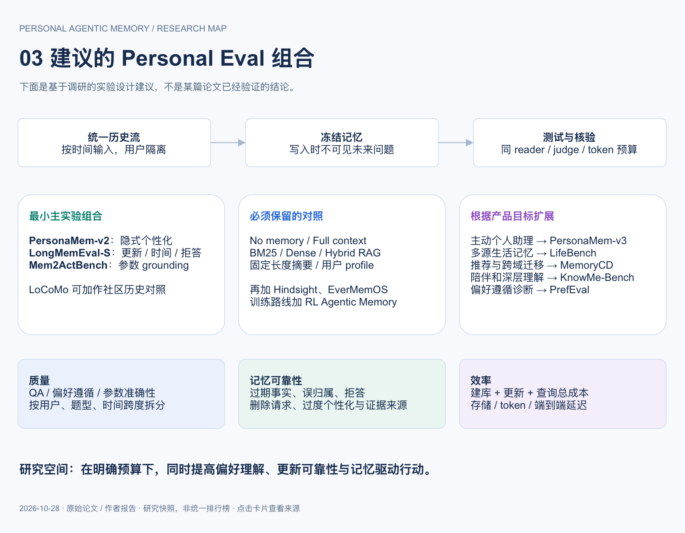

# Personal Agentic Memory 图解

[返回首页](../README.md) · [Benchmark 证据卡](benchmarks.md) · [方法证据卡](methods.md)

沿用前期调研通过 [Next AI Draw.io](https://github.com/DayuanJiang/next-ai-draw-io) 制作的三页图。图为 2026-10-28 的静态快照；细节以证据卡及所引原始来源为准，图中分数不构成同设置排行榜。

[下载可编辑的三页 draw.io 文件](../assets/personal-memory-eval.drawio)

## 1. Benchmark 能力地图

## 2. 方法与结果口径

## 3. 推荐评测组合

